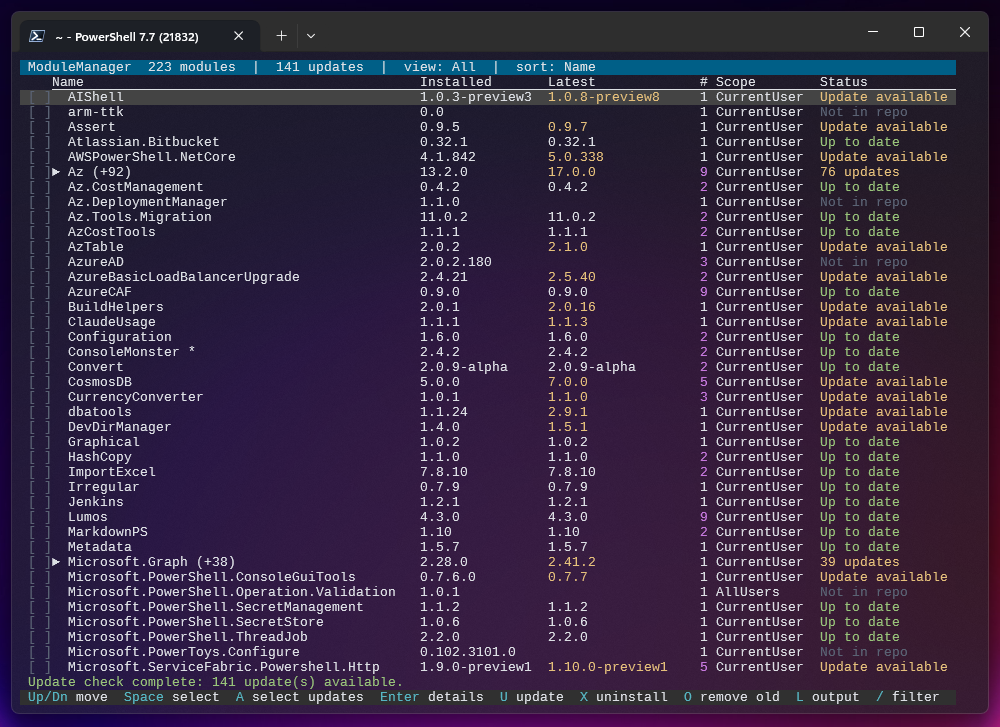
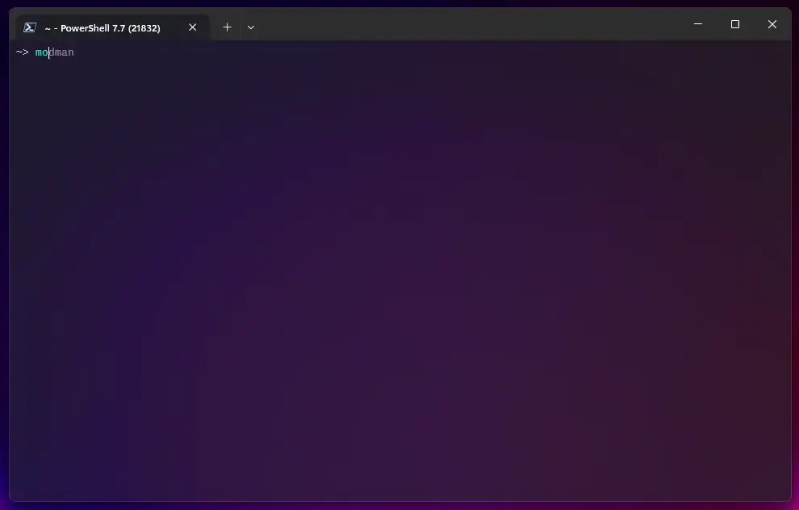

# PowerShell-ModuleManager

[](https://www.powershellgallery.com/packages/modulemanager)

[](https://github.com/markwragg/PowerShell-ModuleManager/actions/workflows/build.yml)

[](https://www.powershellgallery.com/packages/ModuleManager)
[](https://www.powershellgallery.com/packages/ModuleManager)

> A PowerShell module for understanding and managing your other PowerShell modules.

- See which modules you have installed, and every version of each.
- Compare installed versions with the latest version in the gallery.
- Find out where each version is installed, and in which scope.
- Update modules, uninstall them, and clean up old versions.
- Do all of the above from an interactive terminal UI.

Works with **PSResourceGet** (`Microsoft.PowerShell.PSResourceGet`) and falls back to **PowerShellGet** if
PSResourceGet isn't installed.

## Installation

The module is published in the PowerShell Gallery, so if you have PowerShell 5.1 or newer it can be installed by running:

```powershell
Install-Module ModuleManager
```

Or:

```powershell
Install-PSResource ModuleManager
```

> [!TIP]
> Update checks against the PowerShell Gallery, and other NuGet v2 feeds, are fast with either package
> manager, as ModuleManager queries the feed directly. For other repositories (such as file shares) it uses
> the package manager's own commands. With only PowerShellGet (such as the PowerShellGet 1.0 built into
> Windows PowerShell 5.1), those run one at a time, because the PackageManagement module it uses can't be
> used safely from several lookups at once. For the best performance there, install PSResourceGet:
>
> ```powershell
> Install-Module Microsoft.PowerShell.PSResourceGet -Scope CurrentUser
> ```

## Quick start

Interactive UI (Alias: `modman`):

```powershell
Show-ModuleManager
```



Pipe modules to it to open it on just those, such as the ones with updates:

```powershell
Get-ManagedModuleUpdate -Outdated | modman
```

Or open it with a view and sort already set (the same as pressing **V** and **S**):

```powershell
modman -View Updates -Sort Scope     # views: All, Updates, MultipleVersions, Loaded
                                     # sorts: Name, Status, Versions, Scope
modman -NoGroup                      # list module families' members separately, as G does
```

See where modules are installed:

```powershell
Get-ManagedModuleLocation -Summary
```
```plaintext
Order Scope        Modules Versions   SizeMB Path
----- -----        ------- --------   ------ ----
    0 CurrentUser      234      857          C:\Users\someuser\OneDrive\Documents\Pow…
    1 AllUsers           0        0          C:\Program Files\PowerShell\Modules (…
    2 System            14       14          c:\program files\windowsapps\microsof…
    3 AllUsers           5        5          C:\Program Files\WindowsPowerShell\Mo…
    4 System            79       79          C:\Windows\system32\WindowsPowerShell…
```

See what can be updated:

```powershell
Get-ManagedModuleUpdate -Outdated
```
```plaintext
Name                                 Installed        Latest           Status             # Scope        Repository
----                                 ---------        ------           ------             - -----        ----------
AIShell                              1.0.3-preview3   1.0.8-preview8   UpdateAvailable    1 CurrentUser  PSGallery
Assert                               0.9.5            0.9.7            UpdateAvailable    1 CurrentUser  PSGallery
AWSPowerShell.NetCore                4.1.842          5.0.338          UpdateAvailable    1 CurrentUser  PSGallery
Az                                   13.2.0           17.0.0           UpdateAvailable    9 CurrentUser  PSGallery
Az.Accounts                          5.4.0            5.5.5            UpdateAvailable   23 CurrentUser  PSGallery
...
```

## Cmdlets

| Cmdlet | Synopsis |
| --- | --- |
| `Get-ManagedModule` | One row per installed module: newest version, number of versions, scope, repository, path. `-AllVersions` lists each version; `-MultipleVersions` shows only modules with more than one version. `-IncludeSize` adds each module's size on disk and how much removing its old versions would free (`ReclaimableMB`). |
| `Get-ManagedModuleUpdate` | Compares the newest installed version with the latest in the module's repository. Status is `UpdateAvailable`, `UpToDate`, `LocalNewer`, `NotInRepository`, `Unlisted` (withdrawn by its publisher, usually because it's deprecated), `VersionUnlisted` (the newest installed version was withdrawn and there's no newer one; checked for NuGet v2 feeds such as the PowerShell Gallery) or `Error`. |
| `Get-ManagedModuleLocation` | Where every version is installed. `-Summary` gives counts per `PSModulePath` entry; `-IncludeSize` adds disk usage. |
| `Update-ManagedModule` | Installs the latest version into the same scope as the existing one, showing a progress bar. `-RemoveOldVersions` removes the old versions afterwards. Supports `-WhatIf`. |
| `Uninstall-ManagedModule` | Removes modules or specific versions (`-Version 4.*`). With `-OldVersions`, keeps the newest `-Keep` versions of each module and removes the rest. Shows each version's size, and ends by saying how much disk space it freed (or would free, with `-WhatIf`). Supports `-WhatIf` and `-Confirm`. |
| `Move-ManagedModule` | Moves modules or specific versions between the `CurrentUser` and `AllUsers` scopes (`-Destination AllUsers`), updating their install record so PowerShellGet and PSResourceGet still recognise them. Needs an elevated session. Supports `-WhatIf` and `-Confirm`. |
| `Show-ModuleManager` | The terminal UI. |

See the [Documentation](/Documentation/) folder for full help on each cmdlet. The `Get-` cmdlets' earlier names, `Get-ModuleInventory`, `Get-ModuleUpdate` and `Get-ModuleLocation`, still work as aliases.

All of these accept wildcards and pipeline input:

```powershell
Get-ManagedModuleUpdate -Outdated | Update-ManagedModule -RemoveOldVersions -WhatIf
```
```powershell
Get-ManagedModule -MultipleVersions | Sort-Object VersionCount -Descending
```
```powershell
Get-ManagedModule -MultipleVersions -IncludeSize | Sort-Object ReclaimableMB -Descending
```
```powershell
Get-ManagedModuleLocation -Summary -IncludeSize
```
```powershell
Uninstall-ManagedModule Az.* -OldVersions -WhatIf
```
```powershell
Get-ManagedModuleLocation Pester | Where-Object Version -like '4.*' | Uninstall-ManagedModule
```
```powershell
Get-ManagedModuleLocation -Scope CurrentUser | Move-ManagedModule -Destination AllUsers -WhatIf
```

> [!NOTE]
> **Why use `Uninstall-ManagedModule`?**
>
> It works however the module got there. `Uninstall-Module` (PowerShellGet) only removes modules that PowerShellGet installed,
> and `Uninstall-PSResource` only removes ones PSResourceGet installed. Modules copied in by hand, or installed by the other tool,
> fail. `Uninstall-ManagedModule` removes a version whether it came from PowerShellGet, PSResourceGet or a manual copy.

## Terminal UI



```
 ModuleManager  222 modules  |  151 updates  |  view: All  |  sort: Status    | / Updating 76 module(s) 41%
    Name                          Installed       Latest           #  Scope        Status
 [ ]  AIShell                     1.0.3-preview3  1.0.8-preview8   1  CurrentUser  Update available
 [x]► Az (+92)                    13.2.0          17.0.0           9  CurrentUser  75 updates
 [ ]  Az.CostManagement           0.4.2                            2  CurrentUser  Up to date
 [ ]  Pester                      6.2.0           6.2.0           11  CurrentUser… Up to date
 ...
 Output: Updating 76 module(s)  (/ running 1:12)                                    [ ] scroll  L hide
 [################------------------------]  41%  32 of 76: Az.KeyVault 6.3.1 -> 6.4.0
 WARNING: Az.Accounts 5.4.0 is loaded in this session, but Az.Aks 7.1.0 needs [5.5.0, ); ...
 Updating 76 module(s)...
 Up/Dn move  Space select  A select updates  Enter details  U update selected  X uninstall selected ...
```

The update check runs in the background, so you can use the list while it fills in.

| Key | Module list | Details view (Enter) |
| --- | --- | --- |
| ↑ ↓ / PgUp PgDn / Home End (or j k) | Move | Move |
| Space | Select a module (a collapsed family: all of it) | Select a version (kept when you go back, so you can pick versions of several modules) |
| A | Select every module in view with an update (press again to clear). In the Multiple versions view, every module with old versions: **V** to that view, **A**, **O** removes them all | |
| → | Expand a module family, or show versions and paths | |
| ← | Collapse the module family | Back to the list |
| Enter | Show versions and paths | |
| U | Update the selected modules (or the current one). Answer **o** to also remove their old versions | Update this module (**o** also removes its old versions) |
| X / Del | Uninstall everything selected: modules (all versions) and versions | Uninstall the selected versions, of every module |
| M | Move everything selected (or the current module) to the other scope: CurrentUser to AllUsers or back. Needs administrator rights (see below) | Move the selected versions (or the current one) to the other scope |
| O | Remove old versions, keeping the newest | Same, for this module |
| P | | Open the module's project page (or its PowerShell Gallery page) in the browser |
| L | Show or hide the output pane | Same |
| [ ] | Scroll the output pane back and forward | Same |
| / | Filter by name or description. Start with `n:` to match only names, or `d:` only descriptions | |
| V | Cycle the view: All, Updates, Multiple versions, Loaded (or start with `-View`) | |
|   | In the Multiple versions view (100 or more columns wide), the **Reclaim** column shows how much space removing each module's old versions (O) would free, leaving out loaded versions and ones other modules depend on. It shows `...` while it's worked out. Click its heading, or press S, to sort by it, most first | |
| S | Cycle the sort: Name, Status, Versions, Scope, and in the Multiple versions view Reclaim (or start with `-Sort`). Members of an expanded family are sorted the same way, under their family | |
| C | Cycle the scope: All, AllUsers, CurrentUser, System, Other (skipping scopes with no modules). Shows only the modules with a version in that scope, so with the Updates view, `scope: CurrentUser` lists the updates that don't need administrator rights | |
| G | Turn grouping of module families on or off (the help bar says `ungroup` or `group`) | |
| R | Rescan and re-check the repositories | |
| Esc | Close the output pane, then clear the selection, then the filter | Back to the list |
| Q | Quit (Ctrl+C while an operation is running stops it first) | Back to the list |

The details view shows each version's size, with the total, and links to the module's project page and its
PowerShell Gallery page (click one to open it). Below the versions, a panel shows what the version under the cursor
depends on, with the installed version that satisfies each dependency, and which installed modules need it (their
versions that accept it). Only the modules in the list are checked, so a dependency outside it (such as a system
module, unless you use `-IncludeSystem`) shows as not found.

You can also use the mouse. Click a module to move to it, and double-click it for its versions and paths
(right-click to go back). Click its `[ ]` box to select it, a family's arrow to expand or collapse the family, and
a column header (Name, #, Scope, Status) to sort by that column, or `view:`, `sort:` or `scope:` in the title bar to cycle
them. Clicking a key in the help bar presses it, and a confirmation is answered by clicking **y** or **N** (other
clicks are ignored while it's shown). The wheel scrolls the list, the details view, and the output pane when the
pointer is over it. Right-click hides the output pane (or click `L hide` in its header, and `[` or `]` to scroll
it). While modman has the mouse, hold Shift to select text in the terminal, or start it with `-NoMouse` to leave
the mouse to the terminal.

Every action asks for confirmation first, then runs in the background with its progress bar, output, warnings
and errors in a pane at the bottom of the screen. The list stays on screen and you can keep browsing while it
runs. Updates end with one result line per module. When the action finishes, the list is rescanned and the
output stays in the pane until you close it (Esc or L). Only one action runs at a time. Nothing can answer a
prompt while an action runs, so anything that would prompt is asked up front: updating from an untrusted
repository says so in the confirmation. Modules marked `*` are loaded in the current session.

When you update (U), the confirmation offers **y** to update, or **o** to update and then remove the old versions,
keeping the newest, all in one action. It removes the old versions of each module that was updated, and of any
dependencies installed with them; a module whose update failed keeps its old versions. As with O, old versions
that other installed modules depend on are kept, and so are any loaded in the session. From the command line,
`Update-ManagedModule -RemoveOldVersions` does the same.

When you uninstall (X) or remove old versions (O) and some of those versions are loaded in the session, the
confirmation offers a choice: **y** leaves the loaded versions installed, and **f** unloads them from the session
first so they're removed too. modman won't unload a module that uses .NET assemblies (they stay locked until
PowerShell exits, so its folder couldn't be fully deleted), ModuleManager itself, or the package manager it uses.
Those are skipped with the reason, and you can remove them from a new session.

On Windows, you don't need to start modman as administrator to change modules installed for all users. When an
action needs administrator rights (moving modules, or updating, uninstalling or removing old versions of
modules in the `AllUsers` scope) and the session doesn't have them, the confirmation says it runs as
administrator. Windows then asks for permission, and the action runs in a hidden PowerShell process with
administrator rights while modman itself stays as it is. The output pane shows the action's output and progress
as usual, a few lines at a time. If you choose No at the Windows prompt, nothing is changed. Elsewhere, start
PowerShell with `sudo` to change modules installed for all users.

If the update check fails because PowerShellGet needs the NuGet package provider (as Windows PowerShell's built-in
PowerShellGet 1.0 does until it's installed), modman offers to install it for the current user, which doesn't need
administrator rights, and then checks again. It asks once per session. Installing
`Microsoft.PowerShell.PSResourceGet` avoids the need for it altogether.

### Managing another computer

```powershell
modman -ComputerName Server01                      # over WinRM, as you
modman -ComputerName Server01 -Credential $cred
modman -ComputerName Server01 -ConfigurationName PowerShell.7   # PowerShell 7 rather than Windows PowerShell
$s = New-PSSession -HostName linux01 -UserName admin; modman -Session $s   # any transport, such as SSH
```

The UI runs in your console, and scanning, repository checks, updates and uninstalls run on the remote computer,
as the user you connect as and against the repositories registered there. By default `-ComputerName` connects to
Windows PowerShell (the `Microsoft.PowerShell` endpoint), so you see its modules; to manage PowerShell 7's, use
`-ConfigurationName PowerShell.7` (the endpoint `Enable-PSRemoting` registers when run in PowerShell 7). ModuleManager doesn't need to be
installed remotely: it's sent for the session. With `-Session`, your session is left as it is; modman opens its
own connection with the same details and closes it when you quit.

Some differences from managing this computer:

- The repository check and actions share one remote connection, so an action waits for the check to finish
  (R restarts the check at any time).
- "Loaded" means loaded in modman's own session on that computer, which it can't unload, so the **f** choice
  isn't offered. Modules loaded by other sessions there (a service, or another user) can't be seen; removing a
  binary module one of them has loaded fails with an error.
- Against Windows PowerShell 5.1, remote output can arrive all at once when an action finishes rather than as it
  happens.

`modman` itself doesn't work inside `Enter-PSSession` or `Invoke-Command`, which have no console. Use
`-ComputerName` or `-Session` from your own console instead, or the cmdlets through `Invoke-Command`.

### Managing the other PowerShell edition

```powershell
modman -Edition Desktop    # from PowerShell 7: Windows PowerShell 5.1's modules
```
```powershell
modman -Edition Core       # from Windows PowerShell: PowerShell 7's modules
```

On Windows, Windows PowerShell 5.1 and PowerShell 7 install modules into different folders
(`Documents\WindowsPowerShell\Modules` and `Program Files\WindowsPowerShell\Modules`, or `Documents\PowerShell\Modules`
and `Program Files\PowerShell\Modules`), so modman normally shows only some of the other edition's modules: PowerShell 7
sees Windows PowerShell's AllUsers modules but not its CurrentUser ones. `-Edition` manages the other edition's
modules with that edition's own module paths and package manager, through a hidden process of it that closes when
you quit. It works like managing another computer (see above), without needing remoting set up. Every PowerShell 7
version on a computer shares the same module folders, so there's one set to manage for PowerShell 7.

## How it works and safety

- **Fast scan.** ModuleManager reads `$env:PSModulePath` folders and manifests directly instead of calling
  `Get-Module -ListAvailable`. On a machine with about 800 module versions that takes about 1.5 s, against
  about 17 s for `Get-Module -ListAvailable`. The parsed results are cached per folder, so rescans are faster.
- **Parallel, cached gallery lookups.** Lookups run in a runspace pool, which works in both Windows PowerShell
  5.1 and PowerShell 7. A NuGet v2 feed (such as the PowerShell Gallery) is queried directly over its API, 30
  modules per request, which is several times faster than `Find-PSResource` or `Find-Module` for each module:
  about 230 modules take roughly 2 s with either package manager. Other repositories, or a feed that can't be
  reached, are queried with the package manager; with PowerShellGet those queries run one at a time, because
  PackageManagement fails when it's used by several lookups at once. Results are cached for 30 minutes; use
  `-Refresh` to bypass the cache.
- **Scopes.** `CurrentUser` means under your profile. `AllUsers` means Program Files or `/usr/local/share`.
  `System` means it ships with PowerShell (`$PSHOME`) or Windows, and is hidden unless you use
  `-IncludeSystem`. `Other` is anything else.
- **Repositories.** Each module is checked against the repository it was installed from, read from
  `PSGetModuleInfo.xml`. Modules copied in by hand are checked against PSGallery.
- **Uninstalling is protected:**
  - `System` modules are never removed.
  - Loaded modules are skipped unless you use `-Force`.
  - Removing a version that another installed module depends on is blocked unless you use `-Force` (see
    below).
  - `AllUsers` changes require an elevated session.

### Dependencies (for example, the Az modules)

Dependencies are read from the package manager's install record (`PSGetModuleInfo.xml`), including the version
range each module needs. Modules copied in by hand fall back to `RequiredModules` and versioned `ModuleList`
entries in the manifest. This matters for families like Az: the `Az` rollup module pins an exact version of
every `Az.*` module, and the `Az.*` modules need a minimum version of `Az.Accounts`.

- **Removing.** `Uninstall-ManagedModule` refuses to remove a version that a module staying installed needs, and
  `Uninstall-ManagedModule -OldVersions` keeps such versions, with one warning (details with `-Verbose`). For example, old
  `Az.*` versions are kept while the `Az` version that pins them is installed. Remove them together with
  `Uninstall-ManagedModule Az, Az.* -OldVersions`.
- **Updating.** `Update-ManagedModule` updates dependencies first (`Az.Accounts`, then `Az.*`, then `Az`). If an
  update installs another module as a dependency, that module is skipped later in the same run, and `-PassThru`
  shows it with `UpdatedAsDependencyOf`. `-RemoveOldVersions` runs once at the end, so an old rollup and the
  versions it pins are removed together.
- **Loaded modules.** If a module loaded in your session (typically `Az.Accounts`) is older than the new versions
  need, you're warned before anything installs: a module can only be loaded once per session, so start a new
  session to use the updates.
- **Families in the UI.** `modman` shows a module and the `<Name>.*` modules it depends on as one collapsed row,
  such as `► Az (+92)` with the number of updates in the family. Space, U, X and O on a collapsed family act on
  all of it. Right expands it, Left collapses it, and G turns grouping off (or start with `-NoGroup`).

## Building and testing

The build uses [psake](https://github.com/psake/psake), [BuildHelpers](https://github.com/RamblingCookieMonster/BuildHelpers)
and [Pester](https://pester.dev). To install the build dependencies and run the tests:

```powershell
./Build/build.ps1 -ResolveDependency -TaskList 'Init'
./Build/build.ps1 -TaskList 'CombineFunctionsAndStage', 'Analyze', 'Test'
```

The unit tests build fake module trees in a temporary folder and point `PSModulePath` at them. They never touch your real modules or the network.

See [CONTRIBUTING.md](CONTRIBUTING.md) for how releases are deployed.
